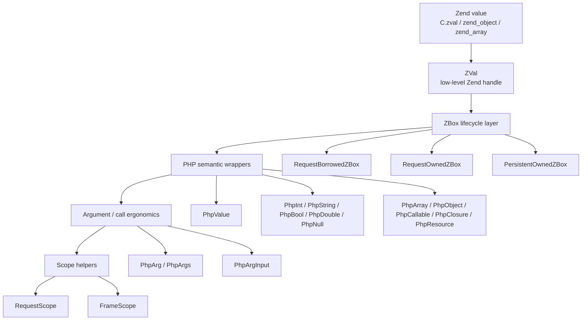
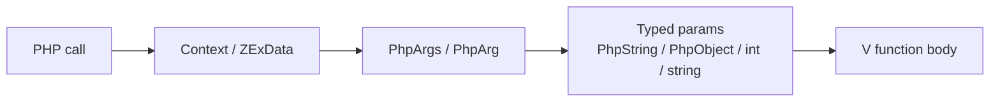
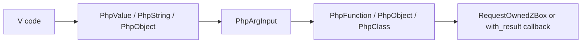
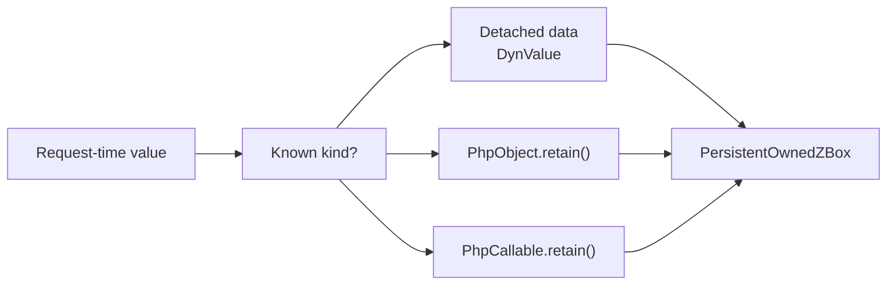

# VPHP Value Layers

This document explains how VPHP value types relate to each other.

Use it when choosing between:

- `ZVal`
- `RequestBorrowedZBox` / `RequestOwnedZBox` / `PersistentOwnedZBox`
- `PhpValue` / `PhpInt` / `PhpString` / `PhpArray` / `PhpObject` / ...
- `PhpArg` / `PhpArgInput`
- `RequestScope` / `FrameScope`

## One Value, Several Questions

A PHP value crosses several boundaries before application code should touch it.
Each layer answers a different question:



| Layer | Main types | Question answered |
| --- | --- | --- |
| Zend | `C.zval`, `zend_object`, `zend_array` | What does the PHP engine store? |
| Low-level handle | `ZVal` | How does V touch the Zend value? |
| Lifecycle | `RequestBorrowedZBox`, `RequestOwnedZBox`, `PersistentOwnedZBox` | How long can this value live, and who releases it? |
| PHP semantics | `PhpValue`, `PhpInt`, `PhpArray`, `PhpObject`, ... | What PHP type does this value mean? |
| Arguments | `PhpArg`, `PhpArgInput` | Does this value carry PHP input metadata, or is it accepted as a PHP call argument? |
| Scopes | `RequestScope`, `FrameScope` | Where are temporary request-owned values released? |

The important rule: do not use a lower layer when a higher layer expresses the
intent clearly.

## `ZVal`

`ZVal` is the bridge-level escape hatch over a Zend value.

Use it for:

- C / Zend bridge helpers
- raw interop code with explicit `_zval` APIs
- implementing semantic wrappers
- places where PHP key type or low-level zval state must be inspected directly

Avoid it in extension application code when a semantic wrapper can say the same
thing:

```v
// Prefer this in application code.
fn greet(name vphp.PhpString) string {
	return 'Hello ${name.value()}'
}

// Keep this style in bridge-level code.
fn greet_raw(name vphp.ZVal) string {
	return 'Hello ${name.to_string()}'
}
```

## `*ZBox`

`ZBox` types add lifecycle and ownership to a Zend value.

| Type | Meaning | Typical source | Release rule |
| --- | --- | --- | --- |
| `RequestBorrowedZBox` | Borrowed view of a request value | PHP arguments, borrowed wrappers | Do not release |
| `RequestOwnedZBox` | Temporary value owned in the current request | PHP call result, `RequestOwnedZBox.new_*`, adopted zval | Release once or hand to a scope |
| `PersistentOwnedZBox` | Long-lived detached data or retained handle | app state, route metadata, cached callables | Owner must release |

Request-owned values are for the current request or call flow. Persistent-owned
values are for long-lived storage. Converting from request to persistent is an
ownership/lifecycle decision, not a PHP type decision.

Common constructors:

```v
borrowed := vphp.RequestBorrowedZBox.of(z)
owned := vphp.RequestOwnedZBox.of(z)
stored := vphp.PersistentOwnedZBox.of(z)
```

When the input kind is known, prefer the explicit persistent constructor:

```v
stored_data := vphp.PersistentOwnedZBox.of_data(dyn)
stored_object := obj.retain()
stored_callable := callable.retain()
```

In extension-facing and framework-facing code, prefer `value.retain()` when the
intent is "keep this PHP value beyond the current request frame". Lower-level
`to_persistent_owned()` / `PersistentOwnedZBox.*` APIs remain lifecycle storage
tools for vphp internals and ownership-sensitive boundaries.

For detached runtime storage data, use:

```v
stored := vphp.DynValue.persistent_owned_zbox(value)
```

`value` may be:

- `DynValue`
- `RetainedObject` for internal object-retention plumbing
- `RetainedCallable` for internal callable-retention plumbing

## PHP Semantic Wrappers

Semantic wrappers describe PHP type intent.

| Wrapper | Meaning |
| --- | --- |
| `PhpValue` | mixed PHP value |
| `PhpNull`, `PhpBool`, `PhpInt`, `PhpDouble`, `PhpString` | scalar/null PHP values |
| `PhpArray` | PHP array |
| `PhpObject` | PHP object |
| `PhpCallable`, `PhpClosure` | callable / closure semantics |
| `PhpResource` | PHP resource |
| `PhpIterator`, `PhpIterable`, `PhpReference`, `PhpThrowable`, `PhpEnumCase` | specialized PHP semantics |

`PhpIterator` means a PHP object that implements `Traversable`; `PhpIterable`
means the PHP iterable shape: `PhpArray | PhpIterator`.

`PhpGenerator` preserves the identity of a native PHP `Generator` in typed
exports. Use `PhpGenerator.from_producer` to build one from V. The producer's
`resume` callback receives the value passed to `send()` or the exception
passed to `throw()`. It returns a keyed yield, an automatically keyed yield,
or a final value for `getReturn()`. The optional `close` callback releases
producer state on completion or when PHP discards the generator.
Use `PhpGeneratorStep.throw_exception(exception)` to propagate the original
PHP exception. Resume inputs are released after the callback unless the
producer yields or retains them, or another PHP reference keeps them alive.

Put PHP objects, callables, and arrays needed across yields in the producer's
`capture` value. The PHP generator frame holds it, and each resume callback
receives it via `input.capture`. Zend can then collect any cycles through that
value. Keep native state in the V closure and use `close` for native cleanup.
Use `close_with_capture` when cleanup needs the same PHP value as `resume`.
It runs once on completion, failure, or disposal, including when PHP drops
a generator before its first resume. If both callbacks are supplied,
`close_with_capture` runs before `close`.

Set `by_reference: true` on the producer and use `yield_reference` or
`yield_keyed_reference` to share an existing `PhpReference` with PHP
`foreach` by reference. To share that binding across resumes, use
`capture: reference.borrowed().to_value()` and recover it with
`input.capture.as_reference()`. Zend can trace the reference and its
current value while the generator is suspended.

`PhpGeneratorStep.yield_from(iterable)` delegates via PHP's native
`yield from`. When the delegate finishes, `resume` receives
`.delegate_resume` with `delegated_return` set, including for PHP `null`.
An exception escaping the delegate is delivered in `exception`.
Zend owns the active delegate and releases its reference before the producer
resumes, including when the delegate terminates with a PHP exception.
PHP reserves delegation for generators that yield by value.

V can drive a PHP generator using `rewind()`, `valid()`, `key()`,
`current()`, `next()`, `send()`, `throw_into()`, and `get_return()`.
Release the request-owned values returned by these operations after use.
Execution errors keep the original PHP exception pending for the export
bridge.

Use `PhpResource.new_stream_context(options)` to create an independent,
request-owned PHP stream context. Pass a `PhpArray` keyed by wrapper name,
with an options array under each wrapper. Release the context after use.

`PhpResource.open_stream(path, mode, context: context, report_errors: false)`
opens a PHP stream with an optional stream-context resource. It returns a
request-owned stream and leaves any PHP exception pending. Use
`stream_wrapper_data()` for a request-owned copy of this stream's wrapper
metadata, including its HTTP status line and headers on PHP's HTTP wrapper.

`PhpResource.connect_stream(address, timeout_ms: 1000, context: context)`
opens a nonblocking TCP or Unix socket. It waits for writability and checks
the socket's connection status. The returned resource is request-owned.
PHP resolves hostnames during transport setup, and the scheduler drives the
socket wait. A failed or cancelled wait releases the socket.

`PhpResource.listen_stream(address, context)` binds an open, nonblocking
`tcp://` or `unix://` PHP socket listener. Use `listener.accept_stream(timeout_ms: 1000)`
to accept a connection. It also accepts a nonblocking listener created
by PHP when the listener exposes its original TCP or Unix URI. The accepted stream is
request-owned, is nonblocking, and inherits the listener's stream context.
A timeout or cancellation leaves the listener available for other accepts.
Closing the listener wakes pending accepts with an error. Keep the listener
nonblocking while it is in use.

`PhpGenerator.from_stream_resource(stream, chunk_size: 8192)` yields binary
strings from the stream's current position. The generator holds a PHP
reference to the resource and reads its first chunk when iteration begins.
Pass `stream: PhpStreamGeneratorOptions{}` to
`PhpGenerator.from_iterable_factory_args()` to let its factory also return
a stream resource and open it on first iteration.
Use `stream_metadata_value()` for the full `stream_get_meta_data()` array
and release the returned `PhpArray` after use. The stream operations
`read(length)`, `write(data)`, `tell()`, and `size()` return an optional
result. A zero byte count or an empty read is a successful result.
Use `read_to_end()` when the remaining bytes must form a complete stream.
It returns an error if a read fails or stops before EOF, and leaves any
original PHP exception pending.
Use `read_exactly(length)` to require a known byte count and leave any
additional bytes unread.
Pass `timeout_ms:` to read exactly that many bytes across short reads on a
nonblocking stream. The timeout covers the whole read, and zero reads only
bytes that are already available. Early EOF and timeout errors report the
byte count already consumed.
Use `read_complete_line(max_bytes)` to require a full line within a byte
limit, including its closing LF. With `timeout_ms:`, it can wait for fragments
of the same line on a nonblocking stream. It leaves any following bytes in
the stream. Bytes consumed before EOF, timeout or a limit error stay consumed.
`seek(offset, origin)` accepts `.start`, `.current`, or `.end`.
All operations act on the original PHP handle and share its cursor with PHP.

Use `PhpFiber` for typed PHP `Fiber` arguments and returns. Create a native
Fiber with `PhpFiber.new(callback)`, then drive it with `start()`,
`start_args()` for PHP named arguments, `resume()`, and `throw_into()`.
`suspend()` exchanges a value with the caller and `get_return()` reads the
final result. Release the request-owned results after use. PHP exceptions
remain pending for the export bridge. `PhpFiber.current()` returns a
request-scoped handle, and `current_id()` provides a context key for
Fiber-local state.

`wait_php_stream(stream, write, milliseconds)` waits for readiness on a
pollable PHP resource and returns false on timeout. It suspends a scheduled
Fiber and also accepts finite waits on the PHP main stack. A timeout of zero
only checks readiness. Use `-1` for an indefinite wait inside a scheduled task.
An exception from a PHP stream wrapper reaches the Fiber that requested the
wait, including when the scheduler rechecks its descriptor.
`wait_php_streams(readable, writable, milliseconds)` accepts PHP arrays of
streams and returns the ready read and write sets with their original keys.
Both sets are empty on timeout.

`wait_for_any_php_task(tasks, owner: owner)` drives the group until a task
settles and returns its position in the input. Read the result or exception
through the original task handle. The caller can drive pending tasks in a later wait.
Pass `timeout_ms` to set a monotonic deadline for the cooperative wait.
A timeout returns `-1`. Passing zero only checks for a settled task.
When task state is stored in PHP objects, pass an owner that references their
handles so Zend can trace dependencies while a Fiber is suspended.
`wait_for_all_php_tasks(tasks, timeout_ms: 1000, owner: owner)` shares one
deadline across the batch and returns false on timeout. The task results
remain on their original handles.
Use `task.failure()` to inspect a failed or cancelled task without raising
its exception in PHP. Release the returned request-owned Throwable after use.
`task.status()` observes whether the task is pending, fulfilled or rejected.
The status query leaves scheduling to the caller.
`task.wait_until_complete_within(1000, owner: owner)` returns whether that
task settled within the deadline. Read its result separately to preserve
a successful null result.

`PhpResource.write_all(data, milliseconds)` writes all input bytes to a
nonblocking PHP stream. It retries short writes and uses the same readiness
backend on backpressure. The timeout covers the whole operation. If a timeout
occurs after a partial write, the error includes the number of bytes already
accepted by the stream. A PHP exception or task cancellation propagates
unchanged. The caller owns the stream and its blocking mode.

`PhpResource.copy_to(destination, length, milliseconds)` copies between two
nonblocking stream resources in chunks. Use `-1` for `length` to copy until
EOF. Reading and writing share a single deadline, and the successful return
value counts bytes written to the destination. On failure, the source may
already have advanced into the current chunk.
Cooperative reads, writes, copies and stream generators check the stream
mode again when a wait ends. A stream that switches to blocking mode
raises an error before the next operation on that stream.

With Boehm, VPHP pauses collection before entering a Zend Fiber stack. On
PHP 8.3+ builds that expose stack bounds and save the switch context on the
Fiber stack, VPHP registers suspended stacks as roots and releases that
thread's pause on the main stack. Other builds, including AddressSanitizer
builds, keep the pause until the last Zend Fiber stack is destroyed.

`PhpWeakReference.create(object)` returns a request-scoped PHP `WeakReference`.
`get()` returns an owned handle to the original object while it is alive, or
`none` after it expires. Release the owned handle when you no longer need to
keep the target alive.

`PhpWeakMap.new()` creates a native PHP `WeakMap`. Use `set`, `find`, and
`remove` with object keys. Use `count()` for the number of entries or
`to_iterable().to_entries()` to collect key-value pairs.
`find` returns a request-owned value for a present key, including a stored
`null`. It returns `none` for an absent key. PHP controls object identity and
removes the entry when it collects the key.

`PhpDateTimeImmutable` maps to PHP's `DateTimeImmutable` in exported
signatures and accepts instances of its subclasses. `parse()` and `now()`
return request-owned values. Formatting and `add()` use PHP's timezone and
calendar rules. `unix_milliseconds_string()` preserves the sign before the
Unix epoch and supports milliseconds beyond the signed integer range.

`PhpDateTimeInterface` accepts mutable `DateTime`, immutable date-times,
and their subclasses. Use it for timestamp and formatting APIs that accept
either kind. `PhpDateInterval.parse()` returns a request-owned PHP
`DateInterval` using PHP's ISO 8601 duration parser.

On PHP 8.4 and later, `PhpClass.new_lazy_ghost()` and `new_lazy_proxy()`
create native lazy objects. Zend passes the ghost to its initializer for
in-place initialization. A proxy initializer returns the backing object.
`PhpObject.is_uninitialized_lazy()` checks state without triggering the
initializer. `initialize_lazy()` returns the initialized ghost or the
proxy's backing object. The constructors and explicit initialization
return request-owned handles.

These wrappers are built on top of `PhpValueZBox`, so they can carry borrowed,
request-owned, or persistent-owned storage while presenting a PHP type API.

Examples:

```v
value := vphp.PhpValue.from_zval(raw)
name := value.require_string()!

arr := vphp.PhpArray.empty()
arr.string('name', 'codex')

obj := vphp.PhpObject.borrowed(raw_obj)
title := obj.method[vphp.PhpString]('title')!
```

Use `with_result(...)` / `with_method_result(...)` for complex temporary return
values so the lifecycle stays inside the callback:

```v
count := vphp.PhpFunction.named('array_filter').with_result[vphp.PhpArray, int](
	fn (filtered vphp.PhpArray) int {
	return filtered.count()
}, items)!
```

Use `call[T]` / `method[T]` for copied scalar wrappers:

```v
length := vphp.PhpFunction.named('strlen').call[vphp.PhpInt](vphp.PhpString.of('codex'))!
```

Invalid call targets raise PHP `TypeError` for positional and argument-array
calls. A PHP exception leaves an invalid result on the raw invocation APIs.
The typed helpers return a V error and leave the original PHP exception pending.

## `PhpArg` And `PhpArgInput`

These names separate the normalized argument object from the broad input shape
accepted by PHP call helpers.

### `PhpArg`

`PhpArg` means: "a PHP argument value, optionally with input metadata".

It carries:

- `value PhpValue`
- optional `PhpArgMeta` with `index`, `name`, and `attributes`

`PhpAttribute` is intentionally generic. `PhpArgMeta.attributes` is only one
mount point; class, function, method, property, or return metadata can reuse the
same `[]PhpAttribute` model when those runtime meta wrappers grow attributes.
`PhpAttribute.target` records the current mount point. `ctx.args_with_meta(...)`
normalizes missing attribute targets to `.parameter`.

Use it when the function needs dynamic access to the original PHP argument list:

```v
arg := ctx.arg_at(0)
name := arg.name()
value := arg.string_value() or { vphp.PhpString.empty() }
```

`Context` exposes two collection helpers:

```v
args := ctx.args()
args_with_decl := ctx.args_with_meta([
	vphp.PhpArgMeta{
		index: 0
		name:  'query'
		attributes: [
			vphp.PhpAttribute.named('FromQuery').string('q'),
			vphp.PhpAttribute.named('Range').int(1).int(100),
		]
	},
])
```

`ctx.args()` reads the actual PHP arguments only. `ctx.args_with_meta(...)`
attaches declaration metadata supplied by generated glue or by a hand-written
`Context` function.

Parameter attributes are available through `PhpArg`:

```v
query := args_with_decl.at(0)
if from_query := query.attr('FromQuery') {
	source := from_query.items[0].value
}

if query.has_attr('Range') {
	// inspect query.attr('Range')!.items
}
```

Normally, exported V functions should prefer typed parameters instead:

```v
@[php_function]
fn hello(name vphp.PhpString, count int) string {
	return '${name.value()}:${count}'
}
```

### `PhpArgInput`

`PhpArgInput` means: "a semantic value shape accepted when V calls a PHP
function, method, or callable".

It is a sum type over semantic wrappers, plus `PhpArg` for pass-through cases:

```v
pub type PhpArgInput = PhpArray
	| PhpArg
	| PhpBool
	| PhpCallable
	| PhpClosure
	| PhpDouble
	| PhpEnumCase
	| PhpInt
	| PhpIterable
	| PhpIterator
	| PhpNull
	| PhpObject
	| PhpReference
	| PhpResource
	| PhpScalar
	| PhpString
	| PhpThrowable
	| PhpValue
```

That lets V call PHP with semantic values directly:

```v
result := vphp.PhpFunction.named('sprintf').call[vphp.PhpString](
	vphp.PhpString.of('hello %s'),
	vphp.PhpString.of('codex'),
)!
```

Use `call_reference(...)` on `PhpCallable`, `PhpClosure`, or `PhpFunction`
when the PHP callable returns by reference. The method returns a request-owned
`PhpReference` that keeps the original PHP variable or property aliased. Call
`release()` when the reference is no longer needed. A by-value result produces
a V error. A PHP exception stays pending so an exported V result can propagate
the original exception.

For direct method calls, use `PhpObject.method_reference(method, ...args)`
or `PhpClass.static_method_reference(method, ...args)`. They use the same
request ownership and preserve the reference returned by the selected PHP
method.

Rule of thumb:

| Direction | Type |
| --- | --- |
| PHP -> V argument metadata | `PhpArg` / `PhpArgs` |
| V -> PHP call argument input | `PhpArgInput` |
| Already typed V-exported function parameter | `PhpString`, `PhpObject`, `int`, `string`, etc. |

## Scopes

### `RequestScope`

`RequestScope` manages request-owned values for a request/call boundary.

Compiler-generated glue uses:

```v
mut vphp_scope := vphp.PhpScope.once()
defer {
	vphp_scope.close()
}
```

Use `PhpScope.request()` when a larger request-level window is needed. Use
`PhpScope.once()` for one call boundary.

Most extension code should not need to call low-level autorelease functions
directly.

Request scopes use the active Zend Fiber's autorelease stack. A V export can
hold a temporary PHP value while its callback suspends, and resuming or
finishing another Fiber leaves that value with its original scope.
Closing a scope releases these references in reverse order, including during
exception propagation or Fiber cancellation. PHP runs any resulting cleanup
and preserves its usual exception chaining.

### `FrameScope`

`FrameScope` is for building temporary PHP call arguments inside one V frame.

It owns the request-owned boxes it creates and releases them all at once:

```v
mut frame := vphp.PhpScope.frame()
defer {
	frame.release()
}

args := [
	frame.string('codex'),
	frame.int(42),
]

mut result := vphp.PhpFunction.named('handler').invoke(...args)
```

Use `FrameScope.args_from_persistent_owned(...)` when long-lived stored values
need to be passed into a request-time PHP callable:

```v
mut frame := vphp.PhpScope.frame()
defer {
	frame.release()
}

args := frame.args_from_persistent_owned(stored_args)
mut result := handler.invoke(...args)
```

`FrameScope` is not persistent storage. It is a short-lived conversion and
cleanup helper.

## Common Flows

### PHP Calls V



Supported parameter styles:

| Style | Example | Use when |
| --- | --- | --- |
| `Context` | `fn handle(ctx vphp.Context)` | Need raw execute data or manual arg access |
| V scalars | `fn add(a int, b string)` | Simple scalar parameters |
| PHP semantic wrappers | `fn run(argv vphp.PhpIterable)` | Want PHP type semantics |
| optional params | `fn value(default ?vphp.PhpValue)` | Missing argument matters |
| `@[params]` struct | `fn create(p CreateParams)` | Named/default argument groups |

Do not combine `Context` with `PhpArgs` as public parameters. `PhpArgs` is
derived from the context inside glue through `ctx.args()` or
`ctx.args_with_meta(...)`.

### V Calls PHP



Prefer semantic call APIs:

```v
upper := vphp.PhpFunction.named('strtoupper').call[vphp.PhpString](
	vphp.PhpString.of('codex'),
)!

sent := conn.with_method_result[vphp.PhpValue, bool]('send',
	fn (result vphp.PhpValue) bool {
	return result.is_valid()
}, vphp.PhpString.of('payload'))!
```

Use `_zval` APIs only at bridge boundaries or when the raw zval behavior is the
point of the code.

### Store For Later



Use:

```v
stored := value.retain()
```

or, at a lower-level lifecycle boundary where detached runtime storage is the
actual target:

```v
stored := vphp.DynValue.persistent_owned_zbox(ref.clone())
```

The owner of a retained semantic value or `PersistentOwnedZBox` must have a
matching `release()` path.

A PHP-owned VPHP object can keep PHP values in the array returned by
`owned_object_php_state(v_ptr)`. The array belongs to the object, so Zend
traces its values together with the object's PHP properties. Use the borrowed
array while the PHP owner is alive. This storage is for inline VPHP wrappers
that own their V instance.

A class can define a mutable `init_php_state()` method to move values prepared
by a V factory into this array. The bridge calls it on the first owned binding
of a returned V object, after its wrapper is registered and before PHP gets
the result. The hook can copy the values into the array and release the
temporary V-side handles. The method is internal unless explicitly exported.

## Naming Rules

Current naming direction:

| Pattern | Meaning |
| --- | --- |
| `from_zval(...)` | Build a semantic wrapper view from an existing `ZVal` |
| `from_request_owned_zbox(...)` | Build a semantic wrapper from `RequestOwnedZBox` |
| `from_persistent_owned_zbox(...)` | Build a semantic wrapper from `PersistentOwnedZBox` |
| `from_persistent_zval(...)` | Preserve a persistent zval payload inside a semantic wrapper |
| `to_zval()` | Expose the underlying zval view |
| `zval()` | Read the underlying `ZVal` from a PHP input argument |
| `zbox()` | Borrow a PHP input argument as `RequestBorrowedZBox` |
| `to_request_owned()` | Materialize an owned request box |
| `persistent_owned_zbox(...)` | Produce `PersistentOwnedZBox` |
| `invoke(...)` / `call_method(...)` / `call_static(...)` | PHP call result as a semantic `PhpValue` |
| `with_result(...)` | Borrow a result inside a callback |
| `_zval` suffix | Low-level escape hatch |

Names should reveal both type semantics and lifecycle semantics. If a helper
returns `PersistentOwnedZBox`, its name should say `zbox`, not just `box`.

## Remaining Edges To Clean Up

The model is now coherent, but a few edges are still worth tightening:

1. `with_request_zval(...)` still exists in vphp internals. That is reasonable at
   the lifecycle boundary, but new application code should prefer semantic
   helpers such as `with_request_value`, `with_request_array`, or
   `with_request_object`.
2. Generated glue still has to touch `Context` and raw argument slots. That is a
   compiler boundary detail; public extension signatures should continue moving
   toward typed scalar/semantic wrappers and `@[params]` structs.
